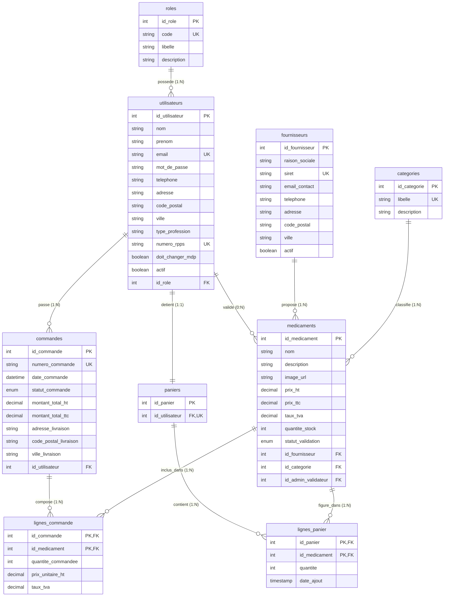

# Schéma de Base de Données Relationnelle MySQL — GSB

> **Projet :** Galaxy Swiss Bourdin (GSB) — Portail E-Commerce pour Professionnels de Santé  
> **Base de données :** `gsb_pharmacie`  
> **Moteur :** MySQL 8.0+ / MariaDB (moteur InnoDB, charset `utf8mb4_unicode_ci`)  
> **Modèle :** Dérivé du Modèle Conceptuel de Données (MCD) MERISE révisé  
> **Date :** Septembre 2026 — Version 1.1  

---

## 1. Architecture et Décisions de Modélisation

### Suppression du lien direct Utilisateur ↔ Fournisseur
Conformément à la réalité métier d'une place de marché médicale B2B :
- **Un professionnel de santé (médecin, pharmacien, officine) n'est pas lié de manière exclusive à un seul fournisseur.**
- Il commande librement auprès de **multiples laboratoires partenaires** (ex. Sanofi, Biogaran, Sandoz) au sein d'un même panier ou d'une même commande.
- La liaison entre les professionnels et les fournisseurs s'effectue donc **indirectement par les commandes** :
  `utilisateurs` ➔ `commandes` ➔ `lignes_commande` ➔ `medicaments` ➔ `fournisseurs`.

---

## 2. Diagramme Relationnel (Entity-Relationship)



---

## 3. Dictionnaire des Tables MySQL

### Table `roles`
| Champ | Type MySQL | Null | Clé / Contrainte | Description |
| :--- | :--- | :--- | :--- | :--- |
| `id_role` | `INT UNSIGNED` | NON | `PRIMARY KEY AUTO_INCREMENT` | Identifiant unique du rôle |
| `code` | `VARCHAR(20)` | NON | `UNIQUE` | `ADMIN`, `PRO_SANTE` |
| `libelle` | `VARCHAR(50)` | NON | | Libellé affiché |
| `description` | `VARCHAR(255)` | OUI | | Description des permissions |
| `created_at` | `TIMESTAMP` | NON | `DEFAULT CURRENT_TIMESTAMP` | Date de création |

### Table `utilisateurs`
| Champ | Type MySQL | Null | Clé / Contrainte | Description |
| :--- | :--- | :--- | :--- | :--- |
| `id_utilisateur` | `INT UNSIGNED` | NON | `PRIMARY KEY AUTO_INCREMENT` | Identifiant utilisateur |
| `nom` | `VARCHAR(50)` | NON | | Nom de famille |
| `prenom` | `VARCHAR(50)` | NON | | Prénom |
| `email` | `VARCHAR(100)` | NON | `UNIQUE` | Email / login de connexion |
| `mot_de_passe` | `VARCHAR(255)` | NON | | Hash sécurisé (bcrypt/argon2) |
| `telephone` | `VARCHAR(20)` | OUI | | Coordonnées téléphoniques |
| `adresse` | `VARCHAR(150)` | OUI | | Adresse du cabinet/officine |
| `code_postal` | `VARCHAR(10)` | OUI | | Code postal |
| `ville` | `VARCHAR(50)` | OUI | | Ville |
| `type_profession` | `VARCHAR(50)` | OUI | | `Médecin`, `Pharmacien`, etc. |
| `numero_rpps` | `VARCHAR(20)` | OUI | `UNIQUE` | N° RPPS d'identification médicale |
| `doit_changer_mdp` | `BOOLEAN` | NON | `DEFAULT TRUE` | Exigence CDC (1er login) |
| `actif` | `BOOLEAN` | NON | `DEFAULT TRUE` | Compte actif / suspendu |
| `id_role` | `INT UNSIGNED` | NON | `FOREIGN KEY (roles)` | Rôle attribué |
| `created_at` | `TIMESTAMP` | NON | `DEFAULT CURRENT_TIMESTAMP` | Date de création |
| `updated_at` | `TIMESTAMP` | NON | `ON UPDATE CURRENT_TIMESTAMP` | Date de mise à jour |

### Table `fournisseurs`
| Champ | Type MySQL | Null | Clé / Contrainte | Description |
| :--- | :--- | :--- | :--- | :--- |
| `id_fournisseur` | `INT UNSIGNED` | NON | `PRIMARY KEY AUTO_INCREMENT` | Identifiant du laboratoire |
| `raison_sociale` | `VARCHAR(100)` | NON | | Dénomination légale |
| `siret` | `VARCHAR(14)` | NON | `UNIQUE` | Numéro SIRET (14 chiffres) |
| `email_contact` | `VARCHAR(100)` | NON | | Email professionnel |
| `telephone` | `VARCHAR(20)` | OUI | | Standard téléphonique |
| `adresse` | `VARCHAR(150)` | OUI | | Siège social |
| `code_postal` | `VARCHAR(10)` | OUI | | Code postal |
| `ville` | `VARCHAR(50)` | OUI | | Ville |
| `actif` | `BOOLEAN` | NON | `DEFAULT TRUE` | Partenaire actif / révoqué |
| `created_at` | `TIMESTAMP` | NON | `DEFAULT CURRENT_TIMESTAMP` | Date d'enregistrement |
| `updated_at` | `TIMESTAMP` | NON | `ON UPDATE CURRENT_TIMESTAMP` | Date de mise à jour |

### Table `categories`
| Champ | Type MySQL | Null | Clé / Contrainte | Description |
| :--- | :--- | :--- | :--- | :--- |
| `id_categorie` | `INT UNSIGNED` | NON | `PRIMARY KEY AUTO_INCREMENT` | Identifiant de la catégorie |
| `libelle` | `VARCHAR(50)` | NON | `UNIQUE` | Nom de la famille médicale |
| `description` | `TEXT` | OUI | | Indications thérapeutiques |
| `created_at` | `TIMESTAMP` | NON | `DEFAULT CURRENT_TIMESTAMP` | Date de création |

### Table `medicaments`
| Champ | Type MySQL | Null | Clé / Contrainte | Description |
| :--- | :--- | :--- | :--- | :--- |
| `id_medicament` | `INT UNSIGNED` | NON | `PRIMARY KEY AUTO_INCREMENT` | Identifiant du médicament |
| `nom` | `VARCHAR(100)` | NON | | Nom commercial (CDC Tableau 4) |
| `description` | `TEXT` | OUI | | Présentation et posologie (CDC) |
| `image_url` | `VARCHAR(255)` | OUI | | Illustration du médicament (CDC) |
| `prix_ht` | `DECIMAL(10,2)`| NON | | Prix unitaire HT catalogue (CDC) |
| `prix_ttc` | `DECIMAL(10,2)`| NON | | Prix unitaire TTC catalogue (CDC) |
| `taux_tva` | `DECIMAL(5,2)` | NON | `DEFAULT 2.10` | Taux TVA pharmaceutique |
| `quantite_stock` | `INT UNSIGNED` | NON | `DEFAULT 0` | Stock physique disponible |
| `statut_validation` | `ENUM(...)` | NON | `DEFAULT 'EN_ATTENTE'` | `'EN_ATTENTE'`, `'VALIDE'`, `'REFUSE'` |
| `id_fournisseur` | `INT UNSIGNED` | NON | `FOREIGN KEY (fournisseurs)` | Laboratoire proposant le produit |
| `id_categorie` | `INT UNSIGNED` | NON | `FOREIGN KEY (categories)` | Famille thérapeutique |
| `id_admin_validateur` | `INT UNSIGNED`| OUI | `FOREIGN KEY (utilisateurs)`| Admin ayant validé le produit |
| `date_validation` | `DATETIME` | OUI | | Horodatage de la validation |
| `commentaire_validation` | `TEXT` | OUI | | Commentaire de modération |
| `created_at` | `TIMESTAMP` | NON | `DEFAULT CURRENT_TIMESTAMP` | Date d'ajout au catalogue |
| `updated_at` | `TIMESTAMP` | NON | `ON UPDATE CURRENT_TIMESTAMP` | Date de mise à jour |

### Table `paniers`
| Champ | Type MySQL | Null | Clé / Contrainte | Description |
| :--- | :--- | :--- | :--- | :--- |
| `id_panier` | `INT UNSIGNED` | NON | `PRIMARY KEY AUTO_INCREMENT` | Identifiant du panier |
| `id_utilisateur` | `INT UNSIGNED` | NON | `UNIQUE, FK (utilisateurs)` | Un panier actif par professionnel |
| `created_at` | `TIMESTAMP` | NON | `DEFAULT CURRENT_TIMESTAMP` | Date de création |
| `updated_at` | `TIMESTAMP` | NON | `ON UPDATE CURRENT_TIMESTAMP` | Dernière modification |

### Table `lignes_panier`
| Champ | Type MySQL | Null | Clé / Contrainte | Description |
| :--- | :--- | :--- | :--- | :--- |
| `id_panier` | `INT UNSIGNED` | NON | `PRIMARY KEY, FK (paniers)` | Réf. du panier |
| `id_medicament` | `INT UNSIGNED` | NON | `PRIMARY KEY, FK (medicaments)` | Réf. du médicament |
| `quantite` | `INT UNSIGNED` | NON | `DEFAULT 1` | Nombre d'unités |
| `date_ajout` | `TIMESTAMP` | NON | `DEFAULT CURRENT_TIMESTAMP` | Date d'ajout |

### Table `commandes`
| Champ | Type MySQL | Null | Clé / Contrainte | Description |
| :--- | :--- | :--- | :--- | :--- |
| `id_commande` | `INT UNSIGNED` | NON | `PRIMARY KEY AUTO_INCREMENT` | Identifiant de commande |
| `numero_commande` | `VARCHAR(50)` | NON | `UNIQUE` | N° de commande lisible |
| `date_commande` | `DATETIME` | NON | `DEFAULT CURRENT_TIMESTAMP` | Date de commande |
| `statut_commande` | `ENUM(...)` | NON | `DEFAULT 'EN_ATTENTE'` | Suivi d'expédition |
| `montant_total_ht` | `DECIMAL(10,2)`| NON | `DEFAULT 0.00` | Total HT |
| `montant_total_ttc` | `DECIMAL(10,2)`| NON | `DEFAULT 0.00` | Total TTC |
| `adresse_livraison` | `VARCHAR(150)`| NON | | Lieu de livraison |
| `code_postal_livraison` | `VARCHAR(10)` | NON | | Code postal |
| `ville_livraison` | `VARCHAR(50)` | NON | | Ville |
| `id_utilisateur` | `INT UNSIGNED` | NON | `FOREIGN KEY (utilisateurs)` | Professionnel acheteur |
| `created_at` | `TIMESTAMP` | NON | `DEFAULT CURRENT_TIMESTAMP` | Date de création |
| `updated_at` | `TIMESTAMP` | NON | `ON UPDATE CURRENT_TIMESTAMP` | Date de mise à jour |

### Table `lignes_commande`
| Champ | Type MySQL | Null | Clé / Contrainte | Description |
| :--- | :--- | :--- | :--- | :--- |
| `id_commande` | `INT UNSIGNED` | NON | `PRIMARY KEY, FK (commandes)` | Réf. de commande |
| `id_medicament` | `INT UNSIGNED` | NON | `PRIMARY KEY, FK (medicaments)` | Réf. du médicament |
| `quantite_commandee` | `INT UNSIGNED` | NON | `DEFAULT 1` | Quantité commandée |
| `prix_unitaire_ht` | `DECIMAL(10,2)`| NON | | **Prix HT gelé à l'achat** |
| `taux_tva` | `DECIMAL(5,2)` | NON | | **Taux TVA gelé à l'achat** |

---

## 4. Fichiers et Exécution

1. **Script SQL prêt à exécuter :** [schema_mysql.sql](file:///home/benladamm/Documents/GitHub/GSB/docs/schema_mysql.sql)
   - Exécution sous MySQL CLI :
     ```bash
     mysql -u root -p < docs/schema_mysql.sql
     ```
   - Ou importation directe dans **phpMyAdmin**, **DBeaver**, ou **VS Code Database Client**.

2. **Schéma Relationnel Draw.io :** [mld_mysql.drawio](file:///home/benladamm/Documents/GitHub/GSB/docs/mld_mysql.drawio)
   - Édition graphique des tables, champs, types et liaisons de clés étrangères.

3. **Aperçu visuel SVG :** [mld_mysql.svg](file:///home/benladamm/Documents/GitHub/GSB/docs/mld_mysql.svg) et [mld_mysql.png](file:///home/benladamm/Documents/GitHub/GSB/docs/mld_mysql.png)
